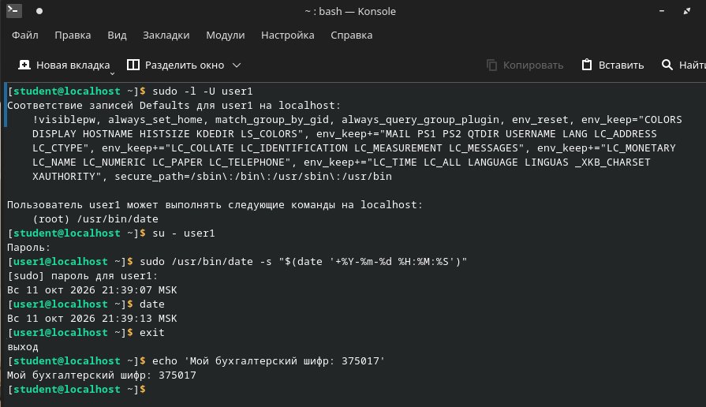

# ДЗ № 1. Изучение средств защиты ОС GNU/Linux

Бухгалтерский шифр: 375017  
Операционная система: РЕД ОС 8.0.3  
Среда виртуализации: Oracle VirtualBox

## Выполнение задания

| Раздел | Задание | Выполнение |
| --- | --- | --- |
| 1. Создание пользователя | 1.1. Создание пользователя | Создан пользователь user1 с UID 1234, включён в группу students. Настроена обязательная смена пароля каждые 90 дней. |
| 2. Мониторинг файлов и процессов | 2.1. Мониторинг файлов | С помощью find выполнен поиск файлов с установленным битом set-UID. Результат сохранён в suid-files.out. |
| 2. Мониторинг файлов и процессов | 2.2. Мониторинг процессов | Найдены процессы с эффективным UID 0 и реальным UID обычного пользователя: fusermount3, su и passwd. Результат сохранён в privileged-processes.out. |
| 3. Изучение механизма set-UID | 3.1. Выбор утилиты | Выбрана утилита cat для чтения учебного файла /root/mephi-secret.txt, доступного только root. |
| 3. Изучение механизма set-UID | 3.2. Выполнение привилегированной операции с помощью механизма set-UID | Создана копия cat-suid, владельцем назначен root, установлены права 4750. До установки set-UID получен отказ в доступе, после — файл успешно прочитан от имени user1. |
| 4. Изучение механизма привилегий | 4.1. Выбор утилиты | Выбрана утилита chown для изменения владельца файла на root. |
| 4. Изучение механизма привилегий | 4.2. Выполнение привилегированной операции с помощью механизма привилегий | Создана копия chown-cap, с помощью setcap назначена привилегия cap_chown=ep. Пользователь user1 успешно изменил владельца файла cap-test.txt на root. |
| 5. Изучение механизма sudo | Разрешение пользователю user1 изменять системное время | В файле /etc/sudoers.d/mephi-user1-time разрешён запуск /usr/bin/date от root через sudo. Правило проверено через visudo. Установка времени от имени user1 выполнена успешно. |
| 6. Сбор артефактов | 6.1. Создание скриншота | Сделан скриншот терминала с бухгалтерским шифром 375017 и проверкой sudo. Файл сохранён как mephi-screenshot.png. |
| 6. Сбор артефактов | 6.2. Создание артефактов ДЗ | Сохранены история команд, сведения о правах доступа, привилегиях, пользователях и группах, настройки sudo и результаты мониторинга. |
| 7. Публикация результатов на GitHub | 7.1. Создание репозитория на GitHub | Создан публичный репозиторий mephi-linux-security-2026 в аккаунте Feym4n. |
| 7. Публикация результатов на GitHub | 7.2. Загрузка файлов в репозиторий GitHub | Артефакты задания и README.md загружены с помощью Git. |
| 7. Публикация результатов на GitHub | 7.3. Проверка доступности | Ссылка на репозиторий: https://github.com/Feym4n/mephi-linux-security-2026. При создании выбран публичный доступ. |

## Артефакты

| Файл | Содержание |
| --- | --- |
| mephi-screenshot.png | Скриншот с бухгалтерским шифром |
| history.out | История выполненных команд |
| stat.out | Права и владельцы домашнего каталога и утилит |
| getcap.out | Результат проверки привилегий |
| passwd | Сведения об учётных записях |
| shadow | Параметры паролей и сроки их действия |
| group | Сведения о группах |
| sudoers | Основная конфигурация sudo |
| mephi-user1-time | Правило sudo из /etc/sudoers.d/mephi-user1-time |
| suid-files.out | Результат поиска файлов с set-UID |
| privileged-processes.out | Результат мониторинга процессов |

## Скриншот

